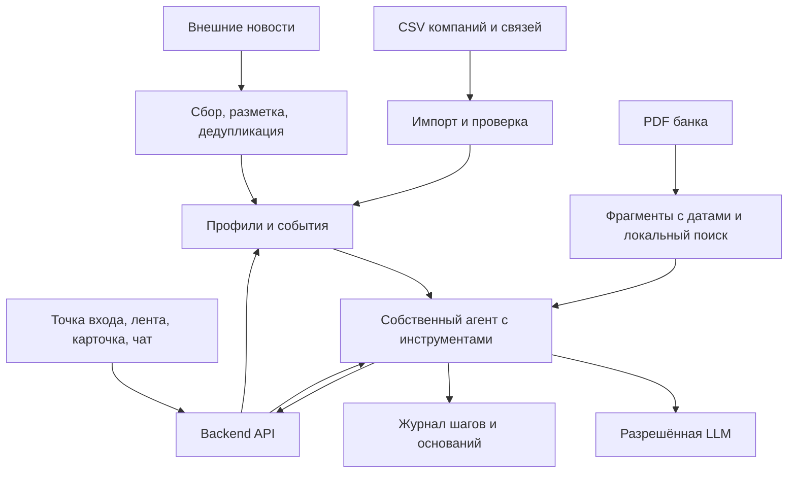

# Архитектура решения

> Предложение от 20.10.2026, [Issue #1](https://github.com/kkonstantin08/hackathon-alfa/issues/1). Приложение ещё не реализовано; стек и интерфейсы не утверждены. Объём: [REQUIREMENTS.md](REQUIREMENTS.md).

## Как читать эту схему

Это набросок будущего сервиса для обсуждения. Сейчас каждый выполняет свою независимую задачу из [ROLES.md](ROLES.md). Когда четыре части готовы, команда показывает результаты и обсуждает архитектуру перед их соединением. Выбор окончательного стека пока открыт.

Схема отвечает на простой вопрос: как из данных компании, новости и материалов банка получить объяснение для пользователя. Технические варианты ниже пригодятся на этой встрече; для начала работы над четырьмя задачами их выбирать не нужно.

## Какие решения готовим уже во время первых задач

На встречу по архитектуре каждый приносит результат проверки и рекомендацию. Формат: какой вопрос проверяли → самый простой вариант → что не получилось → какой вариант сравнили → что выбираем и почему. Сначала проверяем допустимость по кейсу, затем необходимость и качество, потом стоимость и сложность запуска.

| Решение | Кто проверяет независимо | С чего начинаем | Когда меняем подход |
| --- | --- | --- | --- |
| Нужны ли эмбеддинги для поиска по банку | C, на своих вопросах и оригинальных PDF | Поиск по словам в извлечённых фрагментах | Пропускаются нужные фрагменты при перефразировании; локальные эмбеддинги исправляют эти пропуски и помещаются в доступные ресурсы |
| Достаточно ли признаков для персонализации | A, на самостоятельно выбранных компаниях | Исходные признаки без выдуманных показателей | Если признаки почти одинаковые или пустые, отмечаем пределы персонализации и ищем другие доступные признаки до обещаний продукту |
| Нужна ли сложная обработка связей | B, на исходных CSV | Прямые платежные связи и простые суммы/счётчики | Только если найден конкретный полезный сценарий, который не выражается прямыми связями. Наличие таблицы платежей само по себе не требует графовой нейросети |
| Какую разрешённую LLM брать | D, на своих контрольных примерах | Один доступный разрешённый генератор | Другая разрешённая модель проверяется при содержательных ошибках, плохом формате, задержке или неприемлемой стоимости. Все шесть подключать не требуется |
| Нужно ли менять хранилище | A и B отдельно записывают размеры и время обработки своих исходников | Локальные файлы для независимых задач; SQLite как кандидат для приложения | Выбор для приложения зависит от замеренных объёмов и нужной одновременной записи. PostgreSQL выбираем под конкретное ограничение, а не заранее |
| Нужен ли CrewAI как основа | Ограничение проверяем сейчас по кейсу | Собственная агентная логика | При текущих правилах готовый агентный фреймворк не выбираем основным компонентом; отдельного сравнения производительности для этого решения не нужно |

### Проверка поиска: слова или эмбеддинги

RAG означает, что перед ответом модель получает найденные материалы. Поиск для этого может работать по словам. Эмбеддинги представляют текст числами для сопоставления по смыслу; отдельная векторная база из этого автоматически не следует.

Предлагаемый небольшой опыт для C:

1. Самостоятельно подготовить по PDF десять вопросов с известными подходящими фрагментами и пять вопросов, ответа на которые в материалах нет. Часть положительных вопросов перефразировать без повторения слов документа. Сохранить страницу и основания до настройки поиска.
2. Зафиксировать разбиение документов и сравнивать варианты на одинаковых фрагментах. Начать с поиска по словам. Считать, для скольких из десяти ответных вопросов подходящий фрагмент оказался среди первых трёх.
3. Если нужные фрагменты пропускаются, сначала проверить извлечение текста и разбиение PDF. Если текст испорчен или не содержит ответа, эмбеддинги не исправят причину.
4. При содержательных промахах исправного поиска проверить одну локальную embedding-модель на тех же вопросах и фрагментах. Записать успешные/неуспешные вопросы, время индексации и поиска, память и условия запуска.
5. Предлагаемый ориентир для обсуждения: обычный поиск находит основания хотя бы для восьми из десяти положительных вопросов. Если нет, эмбеддинги должны исправить хотя бы два промаха, достигнуть того же ориентира, не внести новых критичных потерь и укладываться в ресурсы. Эти числа нужно принять до опыта; это внутренние ориентиры малого теста, не критерии организаторов и не доказательство качества на всём потоке.
6. Для пяти вопросов без ответа вручную проверить, что найденные похожие фрагменты действительно не дают основания отвечать. Высокая близость не доказывает наличие ответа. Поведение итоговой модели при отсутствии оснований проверяется отдельно при общем запуске. После выбора провести новую проверку на вопросах, не использованных при настройке.

Если обычный поиск проходит выбранную проверку, оставляем его первой версией. Если эмбеддинги дают нужный выигрыш, включаем их. Если оба варианта не проходят, фиксируем нерешённую проблему; сборка сама по себе не превращает неудачный поиск в готовое решение.

multilingual-e5-base остаётся только кандидатом. При его проверке соблюдать [карточку модели](https://huggingface.co/intfloat/multilingual-e5-base): префиксы `query:`/`passage:` нужны и для русского текста; длинные фрагменты обрезаются до 512 токенов. Результат на чужом тесте не заменяет проверку на наших документах.

### Агентная логика и CrewAI

Страница 18 кейса требует собственной логики и запрещает готовые мультиагентные системы как основной компонент. [Документация CrewAI](https://docs.crewai.com/en/introduction) описывает фреймворк для организации потоков и команд агентов. Поэтому CrewAI как ядро продукта не закладываем. Это не общий запрет библиотек для CSV, PDF или эмбеддингов.

Минимальный собственный агент получает профиль и событие, выбирает нужный поиск, проверяет найденные основания и при необходимости меняет запрос. Для проверки нужны три ситуации: основания есть; оснований нет; материалы противоречат друг другу. В журнале должно быть видно различие действий. Повтор одного и того же запроса или однократный ответ модели не закрывает это требование.

### С чем заканчиваем встречу по архитектуре

Для каждого выбора записываем проверенные варианты, исходные примеры, результаты, выбранный вариант и условие пересмотра в [DECISIONS.md](DECISIONS.md). Если данных недостаточно, назначаем короткую дополнительную проверку с владельцем и ожидаемым результатом. Непроверенное предположение не отмечаем как принятое решение.

## Основная идея

Один backend обслуживает UI, хранит профили и новости, ищет по аналитике банка и запускает одного собственного агента с инструментами. Импорт, дедупликация и первичный отбор выполняются обычным кодом. Генеративная модель нужна для интерпретации и уточняющих ответов.

## Предлагаемый стек и компромиссы

Это эскиз будущего приложения. На первом этапе A–D работают независимо с оригинальными входами и собственными примерами по [ROLES.md](ROLES.md); задаче D достаточно скрипта/ноутбука. Стек приложения обсуждаем после сдачи четырёх частей, перед общей сборкой. Постоянные роли распределяем после проверки общего запуска.

| Слой | Предложение | Причина и ограничение |
| --- | --- | --- |
| UI | TypeScript; фреймворк выбрать позже по опыту команды | Один полный сценарий без копии всего банка |
| Backend и данные | Python для обработки и пробного запуска; web-фреймворк позже | Первые результаты можно проверить без API |
| Хранение | SQLite и файлы материалов как кандидат для приложения | Сначала проверить объём и конкурентную запись |
| Поиск | Сначала по словам; локальные эмбеддинги при подтверждённом выигрыше | Сравнить на одних вопросах; сохранять ссылки и проверить память |
| Генерация | Одна основная разрешённая LLM | Выбрать по качеству русского ответа, формату, задержке и стоимости |
| Запуск | Скрипт/ноутбук на старте; Docker для сдачи | Воспроизводимость нужна на обоих этапах |
| Проверки | Проверки подготовленных данных и результата, затем приложения | Сейчас CI проверяет только каркас |

Альтернатива хранения — PostgreSQL, если аудит объёма или конкурентной работы покажет необходимость. Микросервисы, брокер и отдельную векторную БД пока не предлагается вводить. Бесплатный сервер может не вмещать выбранную embedding-модель.

## Подготовка и движение данных

1. Импорт проверяет кодировку, разделители, типы и связи ID. Оригинальные значения и происхождение сохраняются; пропуск не превращается в ноль.
2. Профиль строится по доступным признакам. Наличие кредита/депозита не раскрывает баланс или ставку. Страна ФТС сама по себе не доказывает импорт/экспорт; смысл `NEGATIVEMARK` проверить до использования.
3. Сборщик сохраняет текст новости, ссылку, время публикации и получения, ключевые сведения и признаки дедупликации.
4. Аналитика разбивается на фрагменты с документом, страницей, датой и ID. Поиск учитывает актуальность; старый документ не выдаётся за текущую позицию банка.
5. Лента учитывает профиль и признаки событий. Общие макроновости не исключаются только из-за отсутствия совпадения по отрасли. Формулу ранжирования определить после аудита.
6. Агент получает профиль и событие, ищет основания, проверяет разбор и возвращает его UI. Чат продолжает тот же контекст.

## Минимальный агентный цикл

Инструменты: получить доступный профиль, получить новость, найти аналитику, прочитать выбранный источник. Границы: [CONTRACTS.md](CONTRACTS.md).

Последовательность: план → нужные инструменты → разбор → проверка оснований и полноты → при необходимости уточнение поиска → повторная проверка → ответ или частичный результат. Агент выбирает запросы и повторные действия в ограниченном наборе инструментов. Число шагов и повторов ограничивает сервер.

JSON проверяется кодом. Обоснованность проверяется сопоставлением утверждений с источниками и признаками: валидного JSON недостаточно. Журнал хранит краткий план, действия, основания и результаты проверки, а не скрытые рассуждения модели.

## Бюджет и недоступность ключа

- Ключ хранится только на backend. Учитываются все участники и процессы: 500 ₽ относятся к команде, а не к одному приложению.
- Новости размечаются один раз; разборы повторно используются с учётом версий профиля, новости, корпуса и конфигурации генерации. Изменение оснований делает результат устаревшим.
- Вызовы ограничиваются; при исчерпании лимита или сбое показывается ошибка либо сохранённый разбор с датой. Запрещённый сервис не используется как запасная модель.
- До отключения ключа подготовить синтетические данные и сохранённые результаты. Они помогают проверить UI, но не заменяют живую проверку агента и новых новостей. Порядок проверки после дедлайна согласовать с организаторами.

## Безопасность

- Предлагается демонстрационная учётная запись с явно доступными компаниями. Профиль, разбор, чат и журнал проверяются сервером; переданный ID не даёт право доступа.
- Исходные банковские данные и полные журналы не публикуются в открытом GitHub. Для сдачи используются синтетические данные; допустимость распространения оригиналов уточняется.
- Новости и документы считаются данными, а не командами. Агент не имеет инструментов исполнения кода, банковских операций и произвольного сетевого доступа.
- Сборщик ограничивается выбранными источниками; ссылки не должны давать доступ к внутренней сети или локальным файлам.
- В модель передаётся минимальный контекст. Секреты исключены из запросов, ответов и логов; доступ и сроки хранения журналов определить до развёртывания.

## Проверка и дальнейшее развитие

Сначала A–C независимо готовят профили, связи и аналитику. D собирает небольшой корпус новостей и самостоятельно готовит ручные контрольные входы из оригинальных CSV/PDF для пробного анализатора. Каждая задача имеет собственные проверки и завершается без результатов коллег.

После сдачи четырёх частей проводим встречу по архитектуре: выбираем способ обмена результатами, хранения данных и вызова модели. Затем отдельной задачей подключаем A–C к анализатору D без UI. Проверяем другую компанию, новую новость, недостаточность данных, основания и расход. Интеграция не является условием сдачи исходных четырёх задач.

После проверки общего запуска распределяем профильные роли, уточняем API, строим интерфейс, проверяем сбои и изоляцию компаний. Финал — Docker и проверка в среде показа. Обязанности на первом этапе не определяются анкетными специальностями.

Новые источники подключаются через тот же формат новостей, новые отрасли — через проверяемые признаки профиля и контрольные примеры. Версии материалов и конфигурации позволяют повторить оценку после изменения поиска или модели. Ответственного за сопровождение и регулярные проверки назначить до сдачи.

Структуру каталогов определить после выбора стека; пустые модули заранее не создавать. Людей назначить по [ROLES.md](ROLES.md), решения записывать в [DECISIONS.md](DECISIONS.md).
