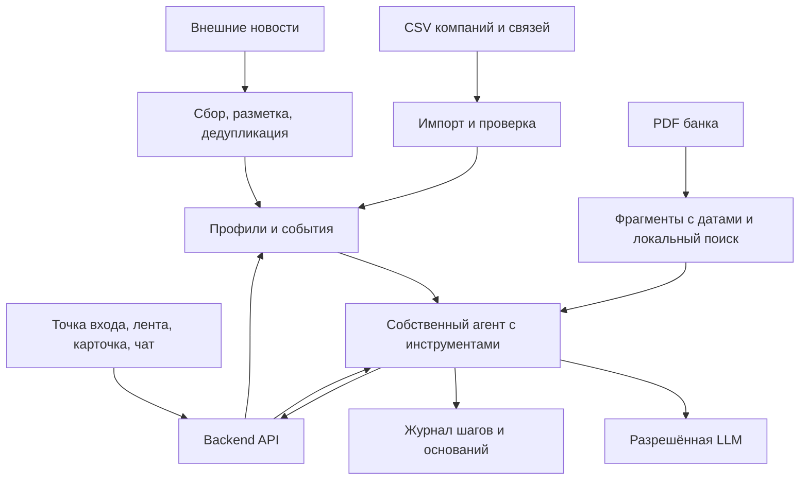

# Архитектура решения

> Предложение от 20.10.2026, [Issue #1](https://github.com/kkonstantin08/hackathon-alfa/issues/1). Приложение ещё не реализовано; стек и интерфейсы не утверждены. Объём: [REQUIREMENTS.md](REQUIREMENTS.md).

## Как читать эту схему

Это набросок будущего сервиса для обсуждения. Сейчас каждый выполняет свою независимую задачу из [ROLES.md](ROLES.md). Когда четыре части готовы, команда показывает результаты и обсуждает архитектуру перед их соединением. Выбор окончательного стека пока открыт.

Схема отвечает на простой вопрос: как из данных компании, новости и материалов банка получить объяснение для пользователя. Технические варианты ниже пригодятся на этой встрече; для начала работы над четырьмя задачами их выбирать не нужно.

## Основная идея

Один backend обслуживает UI, хранит профили и новости, ищет по аналитике банка и запускает одного собственного агента с инструментами. Импорт, дедупликация и первичный отбор выполняются обычным кодом. Генеративная модель нужна для интерпретации и уточняющих ответов.

## Предлагаемый стек и компромиссы

Это эскиз будущего приложения. На первом этапе A–D работают независимо с оригинальными входами и собственными примерами по [ROLES.md](ROLES.md); задаче D достаточно скрипта/ноутбука. Стек приложения обсуждаем после сдачи четырёх частей, перед общей сборкой. Постоянные роли распределяем после проверки общего запуска.

| Слой | Предложение | Причина и ограничение |
| --- | --- | --- |
| UI | TypeScript; фреймворк выбрать позже по опыту команды | Один полный сценарий без копии всего банка |
| Backend и данные | Python для обработки и пробного запуска; web-фреймворк позже | Первые результаты можно проверить без API |
| Хранение | SQLite и файлы материалов как кандидат для приложения | Сначала проверить объём и конкурентную запись |
| Поиск | Локальные эмбеддинги; multilingual-e5 — кандидат | Сохранять ссылки на фрагменты; проверить качество и память |
| Генерация | Одна основная разрешённая LLM | Выбрать по качеству русского ответа, формату, задержке и стоимости |
| Запуск | Скрипт/ноутбук на старте; Docker для сдачи | Воспроизводимость нужна на обоих этапах |
| Проверки | Проверки подготовленных данных и результата, затем приложения | Сейчас CI проверяет только каркас |

Альтернатива хранения — PostgreSQL, если аудит объёма или конкурентной работы покажет необходимость. Микросервисы, брокер и отдельную векторную БД пока не предлагается вводить. Бесплатный сервер может не вмещать выбранную embedding-модель.

## Подготовка и движение данных

1. Импорт проверяет кодировку, разделители, типы и связи ID. Оригинальные значения и происхождение сохраняются; пропуск не превращается в ноль.
2. Профиль строится по доступным признакам. Наличие кредита/депозита не раскрывает баланс или ставку. Страна ФТС сама по себе не доказывает импорт/экспорт; смысл `NEGATIVEMARK` проверить до использования.
3. Сборщик сохраняет текст новости, ссылку, время публикации и получения, ключевые сведения и признаки дедупликации.
4. Аналитика разбивается на фрагменты с документом, страницей, датой и ID. Поиск учитывает актуальность; старый документ не выдаётся за текущую позицию банка.
5. Лента учитывает профиль и признаки событий. Общие макроновости не исключаются только из-за отсутствия совпадения по отрасли. Формулу ранжирования определить после аудита.
6. Агент получает профиль и событие, ищет основания, проверяет разбор и возвращает его UI. Чат продолжает тот же контекст.

## Минимальный агентный цикл

Инструменты: получить доступный профиль, получить новость, найти аналитику, прочитать выбранный источник. Границы: [CONTRACTS.md](CONTRACTS.md).

Последовательность: план → нужные инструменты → разбор → проверка оснований и полноты → при необходимости уточнение поиска → повторная проверка → ответ или частичный результат. Агент выбирает запросы и повторные действия в ограниченном наборе инструментов. Число шагов и повторов ограничивает сервер.

JSON проверяется кодом. Обоснованность проверяется сопоставлением утверждений с источниками и признаками: валидного JSON недостаточно. Журнал хранит краткий план, действия, основания и результаты проверки, а не скрытые рассуждения модели.

## Бюджет и недоступность ключа

- Ключ хранится только на backend. Учитываются все участники и процессы: 500 ₽ относятся к команде, а не к одному приложению.
- Новости размечаются один раз; разборы повторно используются с учётом версий профиля, новости, корпуса и конфигурации генерации. Изменение оснований делает результат устаревшим.
- Вызовы ограничиваются; при исчерпании лимита или сбое показывается ошибка либо сохранённый разбор с датой. Запрещённый сервис не используется как запасная модель.
- До отключения ключа подготовить синтетические данные и сохранённые результаты. Они помогают проверить UI, но не заменяют живую проверку агента и новых новостей. Порядок проверки после дедлайна согласовать с организаторами.

## Безопасность

- Предлагается демонстрационная учётная запись с явно доступными компаниями. Профиль, разбор, чат и журнал проверяются сервером; переданный ID не даёт право доступа.
- Исходные банковские данные и полные журналы не публикуются в открытом GitHub. Для сдачи используются синтетические данные; допустимость распространения оригиналов уточняется.
- Новости и документы считаются данными, а не командами. Агент не имеет инструментов исполнения кода, банковских операций и произвольного сетевого доступа.
- Сборщик ограничивается выбранными источниками; ссылки не должны давать доступ к внутренней сети или локальным файлам.
- В модель передаётся минимальный контекст. Секреты исключены из запросов, ответов и логов; доступ и сроки хранения журналов определить до развёртывания.

## Проверка и дальнейшее развитие

Сначала A–C независимо готовят профили, связи и аналитику. D собирает небольшой корпус новостей и самостоятельно готовит ручные контрольные входы из оригинальных CSV/PDF для пробного анализатора. Каждая задача имеет собственные проверки и завершается без результатов коллег.

После сдачи четырёх частей проводим встречу по архитектуре: выбираем способ обмена результатами, хранения данных и вызова модели. Затем отдельной задачей подключаем A–C к анализатору D без UI. Проверяем другую компанию, новую новость, недостаточность данных, основания и расход. Интеграция не является условием сдачи исходных четырёх задач.

После проверки общего запуска распределяем профильные роли, уточняем API, строим интерфейс, проверяем сбои и изоляцию компаний. Финал — Docker и проверка в среде показа. Обязанности на первом этапе не определяются анкетными специальностями.

Новые источники подключаются через тот же формат новостей, новые отрасли — через проверяемые признаки профиля и контрольные примеры. Версии материалов и конфигурации позволяют повторить оценку после изменения поиска или модели. Ответственного за сопровождение и регулярные проверки назначить до сдачи.

Структуру каталогов определить после выбора стека; пустые модули заранее не создавать. Людей назначить по [ROLES.md](ROLES.md), решения записывать в [DECISIONS.md](DECISIONS.md).
